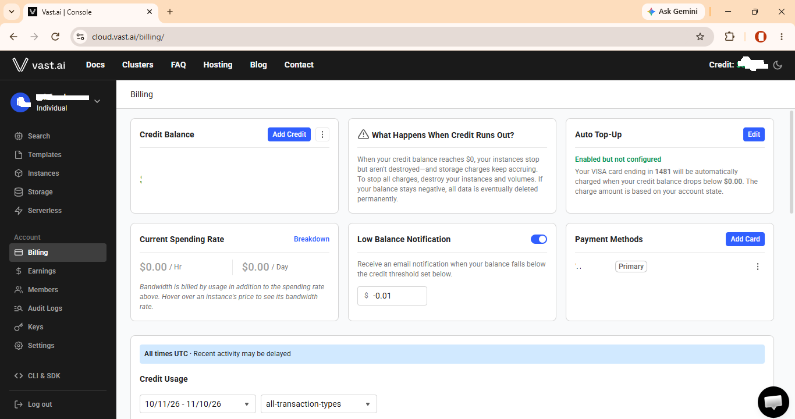
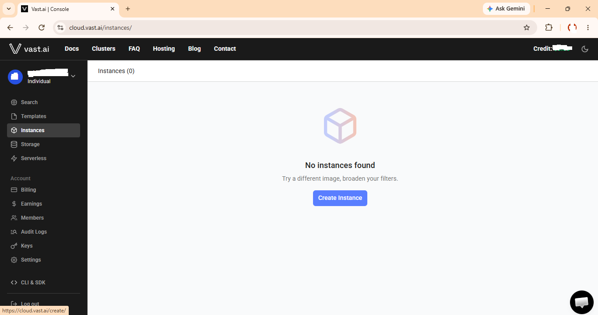
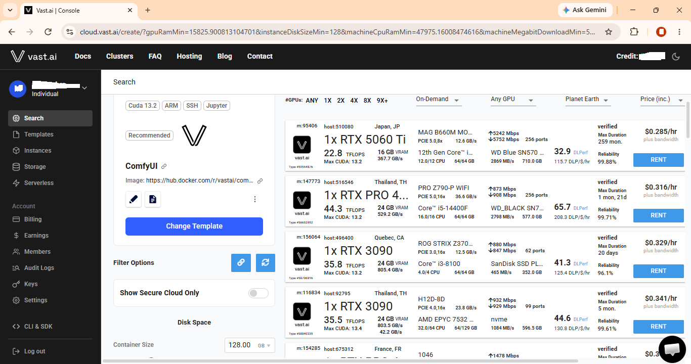
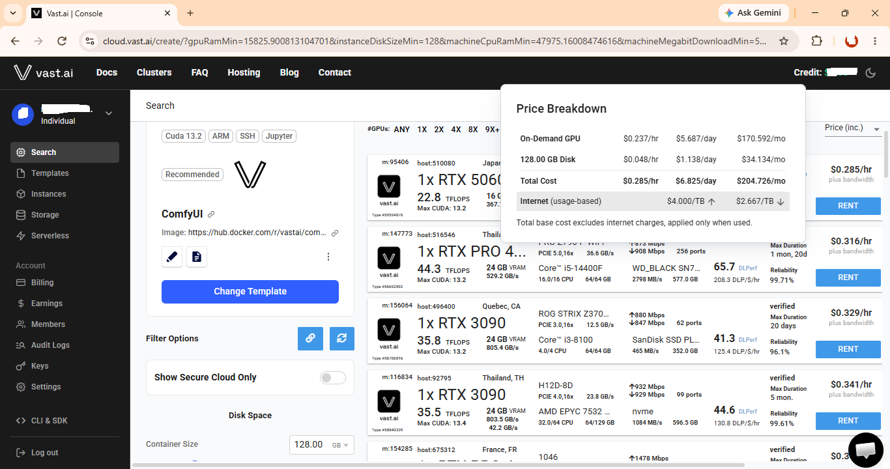
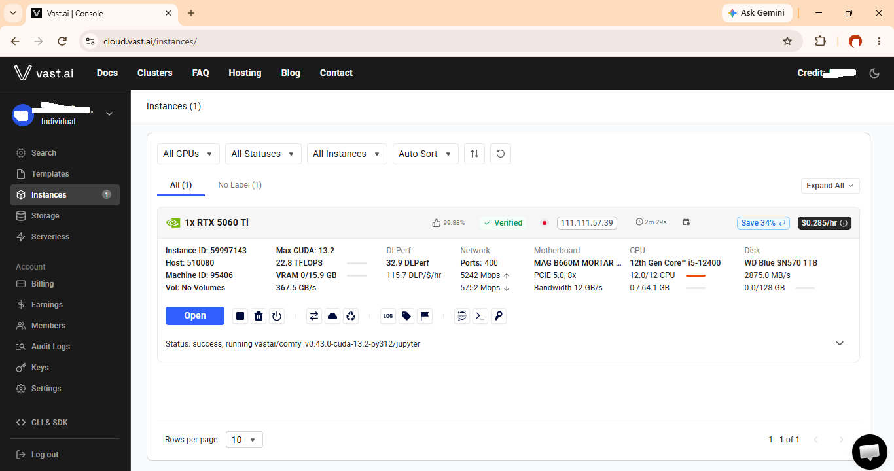
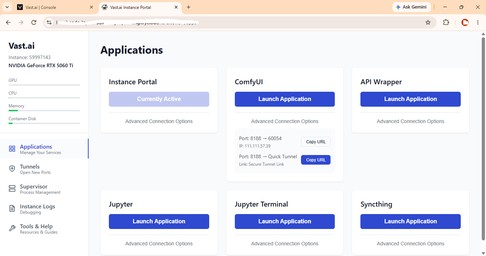
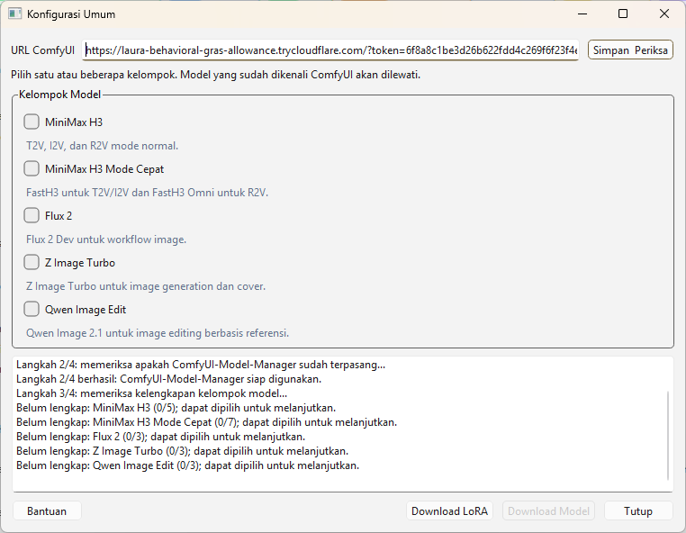
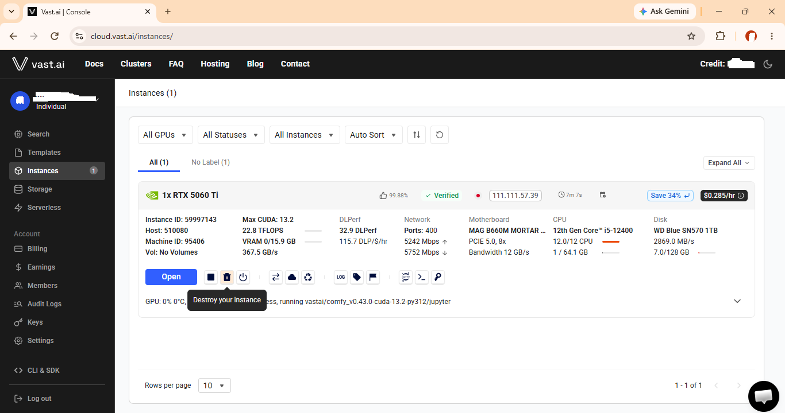

# Video AI Creator

Video AI Creator adalah aplikasi desktop untuk membuat video berbasis adegan. Pengguna dapat membuat project, menyiapkan gambar dan suara, menyusun prompt melalui editor interaktif, lalu menjalankan proses pembuatan video melalui ComfyUI.

Aplikasi ini juga menyediakan bantuan Gemini untuk menyusun prompt, pembuatan suara, pembuatan gambar, penggabungan video, serta pengelolaan model dan LoRA melalui ComfyUI.


## Instalasi Windows

### 1. Pasang Git

Unduh Git dari [git-scm.com](https://git-scm.com/downloads), lalu pasang dengan pengaturan bawaan.

Buka PowerShell dan pastikan Git tersedia:

```powershell
git --version
```

### 2. Pasang Python

Unduh Python dari [python.org](https://www.python.org/downloads/). Saat memasang Python, aktifkan pilihan **Add Python to PATH**.

Pastikan Python tersedia:

```powershell
py --version
```

### 3. Pasang FFmpeg

Unduh FFmpeg dari [ffmpeg.org](https://ffmpeg.org/download.html), lalu tambahkan folder `bin` FFmpeg ke `PATH` Windows.

Alternatif jika `winget` tersedia:

```powershell
winget install --id Gyan.FFmpeg.Shared -e
```

Tutup dan buka kembali PowerShell, lalu periksa:

```powershell
ffmpeg -version
ffprobe -version
```

### 4. Ambil project

Clone repository project, lalu masuk ke foldernya:

```powershell
git clone https://github.com/brainer94/video_ai_creator.git
cd video_ai_creator
```

### 5. Buat virtual environment dan pasang dependency

```powershell
py -3.12 -m venv .venv
.\.venv\Scripts\Activate.ps1
python -m pip install --upgrade pip
python -m pip install -r requirements.txt
```

Jika PowerShell menolak menjalankan `Activate.ps1`, gunakan Python dari virtual environment secara langsung tanpa aktivasi:

```powershell
.\.venv\Scripts\python.exe -m pip install --upgrade pip
.\.venv\Scripts\python.exe -m pip install -r requirements.txt
```

### 6. (Opsional) Siapkan Gemini

Lewati langkah ini jika tidak ingin memakai fitur Gemini. Jika ingin memakainya, buat file `keys.cfg` di folder utama project:

```ini
GEMINIKEY=isi_api_key_gemini_di_sini
```

Ganti nilai contoh dengan Gemini API key yang aktif. Jangan membagikan atau mengunggah file tersebut. File `keys.cfg` sudah dikecualikan dari Git.

### 7. Jalankan aplikasi

```powershell
.\.venv\Scripts\python.exe scene_manager_ui.py
```

Atau jalankan:

```powershell
.\run_ui.bat
```

Saat belum ada project yang dibuka, aplikasi menampilkan panduan awal. Buat project baru melalui menu aplikasi, lalu buka project tersebut sebelum membuat adegan.

## Instalasi Linux

Contoh berikut menggunakan Linux berbasis Debian/Ubuntu.

### 1. Pasang Git, Python, dan FFmpeg

```bash
sudo apt update
sudo apt install -y git python3 python3-venv ffmpeg
```

Pastikan semuanya tersedia:

```bash
git --version
python3 --version
ffmpeg -version
ffprobe -version
```

Python 3.12 direkomendasikan. Jika `python3` pada distribusi Linux terlalu lama, pasang Python 3.12 dari sumber resmi distribusi tersebut terlebih dahulu.

### 2. Ambil project

```bash
git clone https://github.com/brainer94/video_ai_creator.git
cd video_ai_creator
```

Jika menerima project dalam bentuk arsip, ekstrak arsip tersebut lalu masuk ke folder project.

### 3. Buat virtual environment dan pasang dependency

```bash
python3 -m venv .venv
source .venv/bin/activate
python -m pip install --upgrade pip
python -m pip install -r requirements.txt
```

### 4. (Opsional) Siapkan Gemini

Lewati langkah ini jika tidak ingin memakai fitur Gemini. Jika ingin memakainya, buat file `keys.cfg` di folder utama project:

```ini
GEMINIKEY=isi_api_key_gemini_di_sini
```

Ganti nilai contoh dengan Gemini API key yang aktif. Jangan memasukkan file tersebut ke repository atau membagikannya kepada orang lain.

### 5. Jalankan aplikasi

Linux harus memiliki sesi desktop agar jendela aplikasi dapat dibuka.

```bash
./.venv/bin/python scene_manager_ui.py
```

Atau:

```bash
chmod +x run_ui.sh
./run_ui.sh
```

## Menyusun project tanpa ComfyUI

ComfyUI tidak harus dijalankan sejak awal. Anda dapat membuka Video AI Creator terlebih dahulu untuk membuat project, membuat scene, menambahkan aset, mengatur durasi, dan menyusun prompt melalui editor interaktif.

Saat ComfyUI belum aktif, fungsi berikut tetap dapat digunakan:

- membuat dan mengatur project serta scene;
- menulis dan menyimpan prompt secara manual;
- memakai `Buat Prompt` jika Gemini API key tersedia;
- membuat voice Gemini jika Gemini API key dan FFmpeg tersedia;
- membuat gambar Gemini jika Gemini API key tersedia;
- mengatur referensi image, audio, video, LoRA, dan konfigurasi scene;
- menyimpan serta memvalidasi rancangan scene.

ComfyUI baru diperlukan ketika Anda ingin:

- mengunduh model atau LoRA;
- memperbarui daftar LoRA dari ComfyUI;
- membuat gambar dengan Z Image, Flux 2, atau Qwen melalui ComfyUI;
- menjalankan satu atau beberapa scene video;
- melihat Log ComfyUI.

Alur yang disarankan adalah membuat project dan menyelesaikan sebagian besar rancangan terlebih dahulu. Setelah itu, jalankan ComfyUI lokal atau Vast.ai, hubungkan melalui `Konfigurasi Umum`, unduh model yang diperlukan, lalu jalankan proses generasi video. Jika ComfyUI belum aktif saat aplikasi dibuka, aplikasi hanya menampilkan status pemeriksaan pada `Log Proses` dan tetap dapat dipakai untuk menyusun project.

## Koneksi ke ComfyUI

Jalankan ComfyUI, kemudian alamatnya dimasukkan melalui tombol **Konfigurasi Umum**.

Pada dialog tersebut:

1. isi `URL ComfyUI`;
2. tekan `Simpan & Periksa`;
3. baca hasil pemeriksaan di `Log Proses`;
4. unduh kelompok model yang dibutuhkan melalui `Download Model`;
5. gunakan `Download LoRA` jika membutuhkan LoRA tambahan.

Alamat dapat berupa `host:port` atau URL lengkap `http://` / `https://`.

### A. ComfyUI lokal

1. Pasang ComfyUI mengikuti panduan resmi di [repository ComfyUI](https://github.com/comfyanonymous/ComfyUI).
2. Jalankan ComfyUI pada komputer yang sama dengan Video AI Creator atau komputer lain yang terhubung melalui LAN.
3. Pastikan halaman ComfyUI dapat dibuka di browser, biasanya melalui:

   ```text
   http://127.0.0.1:8188
   ```

4. Masukkan alamat berikut pada `Konfigurasi Umum`:

   ```text
   127.0.0.1:8188
   ```

Jika ComfyUI berjalan pada komputer lain di jaringan lokal, gunakan alamat IP komputer tersebut, misalnya `192.168.1.20:8188`. ComfyUI harus mengizinkan koneksi dari komputer Video AI Creator.

Setelah koneksi berhasil, aplikasi akan memeriksa ComfyUI-Model-Manager, model, dan daftar LoRA. Jika model belum lengkap, pilih kelompok model yang diperlukan dari dialog yang sama.

### B. ComfyUI di Vast.ai

#### 1. Siapkan metode pembayaran dan saldo

Buka menu **Billing** di Vast.ai. Gunakan tombol **Add Card** untuk menambahkan metode pembayaran. Vast.ai dapat menggunakan PayPal, kartu kredit, atau kartu debit.



Setelah metode pembayaran tersedia, tekan **Add Credit** untuk menambahkan saldo. Minimal satu kali top up adalah **$5**.

#### 2. Buka menu Instances dan buat instance

Setelah saldo masuk, buka menu **Instances**, kemudian tekan **Create Instance**.



#### 3. Pilih template dan spesifikasi instance

Pada halaman pencarian instance:

- ganti template menjadi **ComfyUI**;
- atur **Container Size** minimal **128 GB**;
- pilih GPU dengan VRAM minimal **16 GB**;
- pilih instance dengan RAM minimal **64 GB** agar proses pembuatan video lebih lancar;
- secara opsional, pilih koneksi internet dengan kecepatan download sekitar **1000 Mbps atau lebih** agar pengunduhan model lebih cepat.



#### 4. Periksa harga lalu tekan RENT

Sorot bagian harga pada instance yang akan dipilih untuk membuka rincian biaya. Periksa biaya GPU per jam, storage, dan internet.



Usahakan biaya internet tidak lebih dari **$4 per TB** untuk download maupun upload. Harga di atas batas tersebut perlu dipertimbangkan dengan hati-hati karena pengunduhan model dapat mencapai sekitar **100 GB** dan membuat biaya internet membengkak.

Jika rincian biaya sudah sesuai, tekan tombol **RENT**.

#### 5. Tunggu sampai instance siap

Buka menu **Instances** dan tunggu sampai instance berstatus siap. Instance dapat digunakan ketika tombol **Open** sudah muncul. Tekan tombol **Open**.



#### 6. Salin URL Quick Tunnel ComfyUI

Pada portal instance, buka **Advanced Connection Options** pada kartu **ComfyUI**. Kemudian tekan **Copy URL** yang berada di sebelah **Quick Tunnel**.



Jangan menggunakan URL Jupyter Terminal atau API Wrapper. Jika URL yang disalin memiliki token, salin URL lengkap beserta bagian `?token=...`.

#### 7. Hubungkan aplikasi ke ComfyUI

Buka Video AI Creator, kemudian buka **Konfigurasi Umum**. Tempel URL yang disalin ke kolom `URL ComfyUI`, lalu tekan **Simpan & Periksa**.



Pantau hasil pemeriksaan melalui **Log Proses**. Setelah koneksi berhasil, model dan LoRA dapat dikelola melalui dialog yang sama.

Pengguna tetap mengatur siklus hidup instance melalui console Vast.ai. Setelah koneksi berhasil, model dan LoRA dapat dikelola dari **Konfigurasi Umum** tanpa SSH. ComfyUI-Model-Manager akan diperiksa dan dipasang bila diperlukan oleh aplikasi.

#### 8. Hancurkan instance setelah selesai

Setelah selesai menggunakan ComfyUI, kembali ke menu **Instances** di Vast.ai dan tekan **Destroy your instance**. Langkah ini penting agar billing instance berhenti.



## Gemini (opsional)

Gemini bukan syarat untuk menjalankan aplikasi. Tanpa Gemini API key, aplikasi tetap dapat digunakan untuk mengelola project dan scene, memakai ComfyUI, membuat gambar melalui model ComfyUI, mengunduh model dan LoRA, serta menggabungkan video dan audio.

Jika ingin memakai fitur Gemini, buat file `keys.cfg` di folder utama project dengan isi berikut:

```ini
GEMINIKEY=isi_api_key_gemini_di_sini
```

Ganti nilai contoh tersebut dengan Gemini API key yang aktif. Jangan menambahkan tanda kutip, jangan membagikan file ini, dan jangan mengunggahnya ke repository.

Gemini API key digunakan untuk fitur-fitur berikut:

- `Buat Prompt` pada editor prompt;
- `Buat Voice` menggunakan Gemini TTS, termasuk pemuatan katalog voice Gemini 3.8;
- pembuatan gambar awal jika model Gemini dipilih;
- pembuatan cover project jika model Gemini dipilih.

Tanpa key, atau jika key tidak valid, aplikasi tetap dapat dibuka. Hanya fitur-fitur Gemini tersebut yang akan gagal dan pesannya ditampilkan melalui Log Proses. Fitur gambar melalui Z Image, Flux 2, atau Qwen tetap menggunakan ComfyUI dan tidak memerlukan Gemini API key.
